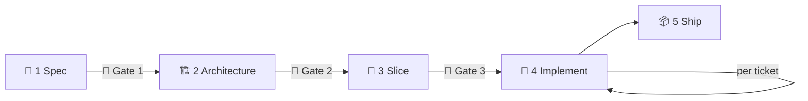

<div align="center">

# 🪶 harry-skills

**Agent skills that take a feature from idea to code you can trust.**


</div>

You plan the work with the agent in three steps and approve each plan. The agent then builds alone, one small ticket at a time, and runs the real system to prove that each ticket works.

## 💡 Explanation

### Why it exists

Each skill answers one way that agent coding goes wrong.

| 😵 Problem | 🛠️ Fix |
|---|---|
| The agent assumes a lot and ignores the user journey. | `ask-until-clear` interviews you until nothing is assumed. `spec-it` turns the answers into journeys and numbered acceptance criteria. |
| Architecture is never modeled or approved. | `designing-architecture` compares at least two designs, sketches the winner, and picks the test seams. You approve it before any ticket exists. |
| Test cases are never validated. | `reviewing-changes` picks places where the code should break. The agent breaks each one and confirms that a test fails. |
| The agent writes too much code before review. | `slicing-tickets` cuts the plan into small vertical tickets. Each ticket is built in a fresh subagent. |
| Output is never run in a real environment. | `prove-it-work` drives the real system through its CLI, API, or browser, saves the evidence, and reports `VERIFIED`, `NOT VERIFIED`, or `INCONCLUSIVE`. |
| Long sessions degrade. | Tickets get fresh contexts, and `handoff` compresses a session into `pause.md`. |

### How it works

Work moves through five steps. You approve the first three. The agent runs the last two.



| Gate | You approve | Skill that produces it |
|---|---|---|
| 1 | The journeys and how each one is checked end to end | `ask-until-clear`, then `spec-it` |
| 2 | The architecture | `designing-architecture` |
| 3 | The tickets and their e2e scenarios | `slicing-tickets` |

From gate 3 on, each ticket runs through TDD, a fresh-subagent review, and a fresh-subagent verify. The agent stops for you after `T01` and after every ticket marked `Review: human`. It also parks a ticket and writes `stops/T04.md` in three cases: three attempts fail, a decision is yours to make, or the next step cannot be undone.

`shipping-features` reviews the whole feature, runs every journey on the finished branch, and tags the evidence as `evidence/<feature>`. It reports in chat and opens no pull request, so you decide how to merge.

A small change skips steps 1 to 3. `handon` proposes the size, and you confirm it in one line.

### Where the state lives

There is no state file. `handon` reads git and the `Status` line of each file, so any session can resume.

```
docs/features/<feature>/
├── spec.md              Status: draft | approved
├── architecture.md      Status: draft | approved
├── tickets/T01-*.md     Status: draft | todo | parked | done
├── stops/T04.md         why a ticket was parked
├── evidence/T04/        transcripts, responses, screenshots
└── pause.md             written by handoff, deleted by handon
```

### Skills

| | Group | Skills |
|---|---|---|
| 🧭 | **start** | `handon` (entry point), `ask-harry` (which skill now), `setup`, `make-way`, `handoff` |
| 🗺️ | **plan** | `ask-until-clear`, `term-guard`, `understand-this-code`, `research`, `prototyping-designs`, `spec-it`, `designing-architecture`, `slicing-tickets` |
| 🔧 | **build** | `implementing-tickets`, `reviewing-changes`, `prove-it-work`, `shipping-features`, `debugging-failures` |
| ✍️ | **craft** | `quill-technical-writing`, `quill-unslop`, `learn-from-mistakes`, `evaluating-skill` |

`handon`, `ask-until-clear`, and `term-guard` can start on their own. The other skills set `disable-model-invocation`, so you start them by name or `handon` routes to them.

## 🚀 How-to

### Install from the marketplace

```
/plugin marketplace add harrymadison297/skills
/plugin install harry-skills@harry
```

### Try a local clone

```
claude --plugin-dir /path/to/skills
```

### Find the right skill

Run `/harry-skills:ask-harry` and describe what you are doing. It names the one skill to run, says why, and stops. To build or resume a feature, run `handon` directly.

### Build a feature

1. Run `/harry-skills:handon`. It reports the branch, the base files, and each feature's step, then routes you.
2. Answer the interview, then approve `spec.md` (gate 1) and `architecture.md` (gate 2).
3. Read the ticket graph and approve the tickets (gate 3). The agent cannot change the e2e scenarios afterward.
4. Let the agent build. At a checkpoint, read the diff and the evidence, then say "continue". If a ticket is parked, read its stop report.
5. Read the report from `shipping-features` and merge.

### Resume or pause

- To resume, run `/harry-skills:handon` again.
- To stop with a full context, run `/harry-skills:handoff`, start a new session, and run `handon`.

### Reuse the docs your repo already has

Run `/harry-skills:setup`. It records where the repo keeps its glossary, coding standard, ADRs, and run instructions in a `Workflow files` block in `CLAUDE.md` or `AGENTS.md`.

### Teach the agent to run your app

Run `/harry-skills:make-way`. It writes `.claude/skills/verify-<app>/SKILL.md`, which `prove-it-work` reads to start and drive the real system. Run it before the first build, and again when the app changes.

### Fix a hard bug

Run `/harry-skills:debugging-failures`. It builds a command that fails on demand before it forms a theory.

### Test a skill

Run `/harry-skills:evaluating-skill` on the skill. It writes 3 to 6 cases, waits for your approval, runs them blind against a no-skill baseline, and reports what the skill adds.

### Write or clean up a doc

Run `/harry-skills:quill-technical-writing` for docs, commit messages, and PR bodies. Run `/harry-skills:quill-unslop` on any text that reads as machine-written.

## 📚 Docs

| Page | Content |
|---|---|
| [docs/workflow.md](docs/workflow.md) | The flow, which skill calls which, status and resume, and the folder layout. |
| [docs/sources.md](docs/sources.md) | Where each skill came from, with licenses. |

Each `SKILL.md` is the source of truth. Where `docs/workflow.md` disagrees with a skill, the skill wins.

## 🙏 Credits

`ask-until-clear` and `term-guard` are adapted from [mattpocock/skills](https://github.com/mattpocock/skills) (MIT).
