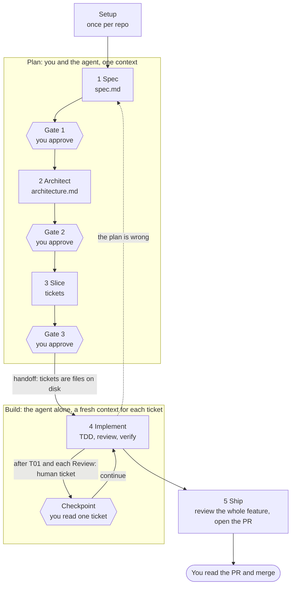
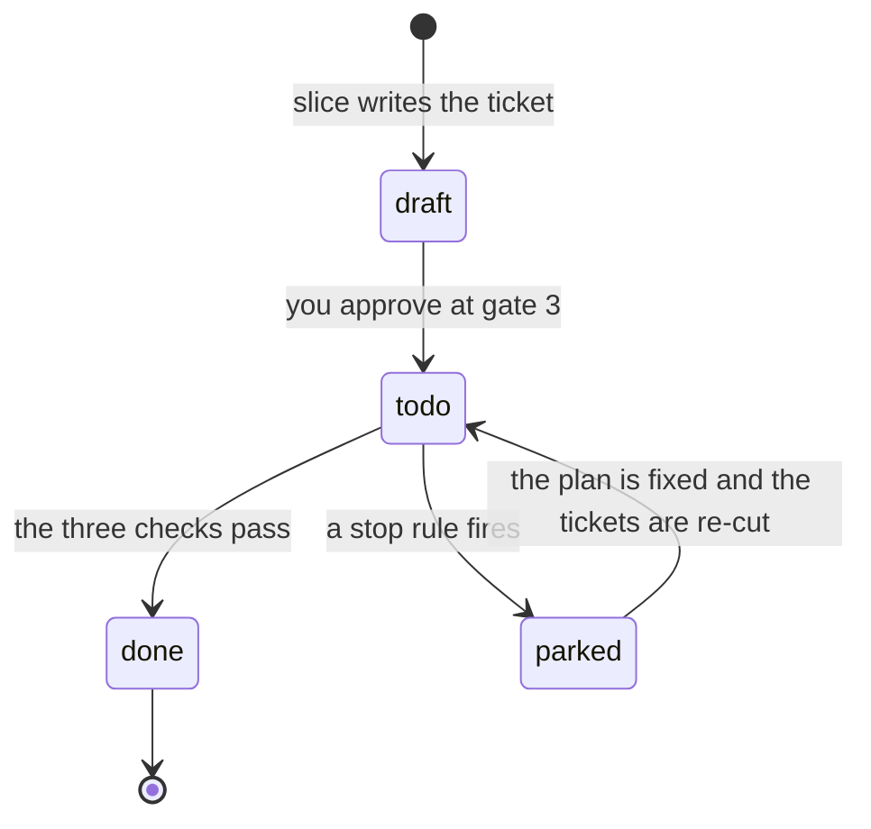
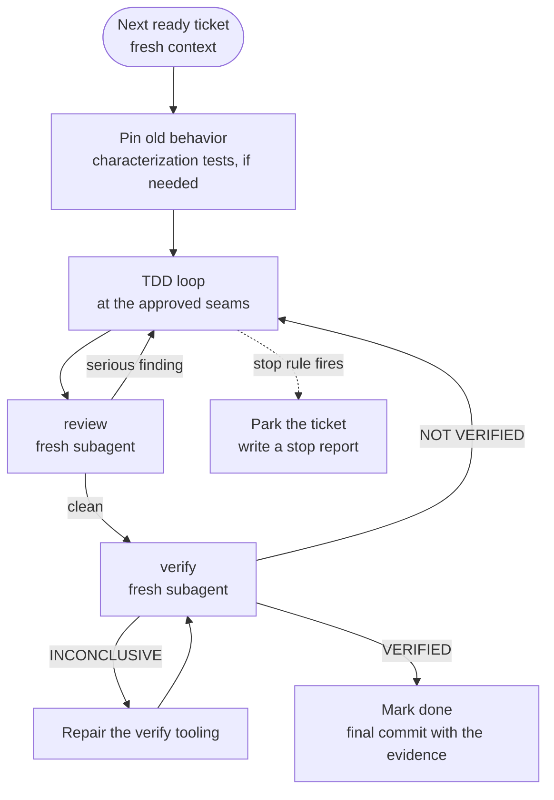

# How the workflow runs

The workflow takes a feature from an idea to a merged pull request. You plan the work with the agent in three steps. The agent then builds it alone, one ticket at a time, and you read the result.

This page lists each step, the skills that run in it, and what each skill is for. The skills named here are the target set, so treat this page as the design that the skills are built to match. The agent does not load this page. Each skill carries its own instructions in its `SKILL.md`.

## The flow at a glance



| Step | Skills | Output | Who decides |
|---|---|---|---|
| Setup | `setup` | `GLOSSARY.md`, `docs/standards.md`, ADR folder, `verify-<app>/` | You approve the list of files |
| 1 Spec | `spec-it`, `prototyping-designs`, `research` | `spec.md` | You, at gate 1 |
| 2 Architect | `designing-architecture` | `architecture.md`, ADRs | You, at gate 2 |
| 3 Slice | `slicing-tickets` | `tickets/T*.md` | You, at gate 3 |
| 4 Implement | `implementing-tickets`, `reviewing-changes`, `prove-it-work` | Commits, evidence | The agent, with you at checkpoints |
| 5 Ship | `shipping-features`, `learn-from-mistakes` | A pull request | You, by reading and merging |

Three kinds of stop appear in the flow.

| Stop | Where | What happens |
|---|---|---|
| Gate | After steps 1, 2, and 3 | The agent stops until you approve. |
| Checkpoint | Inside step 4 | The agent stops so you can read one finished ticket. You say "continue". |
| Check | Inside step 4 | The agent tests a condition on its own before it marks a ticket done. |

A wrong idea is cheapest to fix at the start. A misunderstood journey costs one conversation in step 1. The same mistake found in step 4 costs a spec, an architecture, and code. The flow therefore puts you in steps 1 to 3 and brings you back in step 4 only at the checkpoints.

## How you start: `build-a-feature`

Run `build-a-feature` to start or resume. It is the only skill that the model may start on its own.

| Skill | What it does | Why it exists |
|---|---|---|
| `build-a-feature` | Reads the `Status` lines in the feature folder and the git log, finds the current step, and runs the next skill. Proposes a size for the change, and you confirm in one line. Records your approvals. | You should not need to remember where you are or which skill comes next. |

**Two sizes.** A *small* change is one ticket that touches no public contract, no data, and nothing unclear. It skips steps 1 to 3: the agent writes the ticket, shows you its e2e scenario, and goes to step 4 with no checkpoint. Every other change is *full* and runs all five steps.

**Status and resume.** `spec.md` and `architecture.md` carry `Status: draft` or `Status: approved`. A ticket moves through the states below. Only `build-a-feature` sets `approved`, and only after you say so. Editing an approved file sends it back to `draft` and reruns its gate. The current step is the first one whose file is missing or still `draft`. There is no separate state file, because it would drift from the commits. After a crash, discard the uncommitted changes and run `build-a-feature` again. The last commit is always green.



A ticket is *ready* when it is `todo` and every ticket that blocks it is `done`. The ticket graph computes this, so no file stores it.

## Setup: once per repo

| Skill | What it does | Why it exists |
|---|---|---|
| `setup` | In an existing repo, reads first: maps the code, finds the build, test, and CI commands, and finds the ADRs, the tracker, and the conventions that the repo already has. The repo's conventions win over the defaults of this set. In a new repo, asks which stack you want and which environments you can test in. Lists every file it will write, waits for your approval, writes them, and runs `prove-it-work` once to prove that the setup works. Running it again only updates files and shows the difference. It never overwrites. | The later steps need a glossary, a coding standard, and a way to run the real system. Without them, each skill invents its own, and nothing can be proven to work. |

Files that `setup` writes:

| File | Content |
|---|---|
| `GLOSSARY.md` | Domain terms |
| `docs/standards.md` | The coding standard that `reviewing-changes` reads, plus the command for the mutation tool if the language has one |
| `docs/adr/` | Where architecture decisions go |
| `.claude/skills/verify-<app>/` | The environments you can verify in (your machine, a container, a virtual machine, several operating systems), each with a cost label `fast` or `slow`, how to start the system in it, how to drive it, and how to clean up |

## Step 1: spec

Goal: agree on what to build before anyone discusses how.

| Skill | What it does | Why it exists |
|---|---|---|
| `spec-it` | Interviews you in rounds and writes `spec.md`. If the feature touches existing code, it runs `understand-this-code` first so it does not ask what the code already answers. It opens with its assumptions for you to accept or reject. Each round asks every question that does not depend on another open question, with a recommended answer for each. It updates `GLOSSARY.md` when a term is settled. | An agent that does not ask will assume, and it will assume the wrong user journey. This skill moves the assumptions out of the agent's head and into a file that you approve. |
| `prototyping-designs` | Builds throwaway code to answer a question that needs something running. When the question is answered, it deletes the code and keeps only the decision, in `spec.md`. | Some questions cannot be settled by talking. A prototype settles them cheaply and leaves no code that someone might ship by accident. |
| `research` | Answers a technical question from primary sources, such as official docs and specifications, and saves the answer with citations. | An agent that answers from memory can state a wrong API fact with confidence. A cited note lets you check the source. |

`spec.md` holds the following.

| Section | Content |
|---|---|
| Goal | The problem and the user, in a few sentences |
| Journeys | A **journey** is a path that a user takes to reach a goal, such as `J1`. Each concrete run is a test path, such as `J1.2`. The "user" can be a person, an API caller, a scheduled job, or another system. For a pure refactor, the journey is the existing behavior that must stay the same. |
| Acceptance criteria | `AC1`, `AC2`, and so on. Each criterion passes or fails, uses no subjective words, and names the journey it serves. Non-functional needs such as speed or security are criteria too, with a threshold and a way to measure it. |
| Non-goals | What this feature does not do |
| Decisions | What the interview and the prototypes settled |

**Gate 1.** You approve `spec.md`. Check that each journey matches what the user needs and that one test or one e2e step can test each criterion.

## Step 2: architect

Goal: decide the shape of the system, and which boundaries the tests will watch, before any code exists.

| Skill | What it does | Why it exists |
|---|---|---|
| `designing-architecture` | Writes `architecture.md`. Sketches the types, signatures, and module boundaries, with function bodies left "not implemented". Compares at least two designs that differ in structure, not only in detail. Picks the seams to test. Writes an ADR for each decision that is hard to reverse, would surprise a later reader, and has a real trade-off. Writes an RFC for a question that cannot be settled yet and names the tickets it blocks. | The shape of a system is cheapest to change before code grows around it. Seams chosen here keep the tests tied to behavior, so they survive refactors. |

A **seam** is a public boundary where a test observes behavior without touching the inside. The skill prefers a seam that already exists, picks the highest seam that works, and aims for as few seams as possible. Every criterion needs at least one seam that can observe it. If a criterion has none, you go back to step 1 and rewrite the criterion.

**Gate 2.** You approve the sketch, the seams, and the ADRs. The sketch is a contract. If a later step must depart from it, the agent reports the departure and does not absorb it silently. No ticket is cut and no test is written until you approve.

## Step 3: slice

Goal: cut the plan into pieces that one agent can build, review, and verify in a fresh context.

| Skill | What it does | Why it exists |
|---|---|---|
| `slicing-tickets` | Writes the tickets in `tickets/` and a script that prints the ticket graph. Runs again in a re-cut mode when a ticket fails because the plan was wrong: done tickets stay unless the fix makes them wrong, unfinished tickets are rewritten or deleted, and new ones are added. | Code that arrives in large pieces cannot be reviewed. Small tickets with their own pass-or-fail checks let the agent work alone and let a reviewer judge each piece. |

Rules that `slicing-tickets` follows:

| Rule | Detail |
|---|---|
| Vertical, not horizontal | A ticket is a narrow path through every layer the feature touches, such as schema, API, CLI, and interface. It never covers one layer only. |
| Small | A ticket can be demonstrated or verified on its own and fits one context. |
| Ordered | Each ticket lists the tickets that block it. |
| Walking skeleton | `T01` is the thinnest slice that runs one real test path. Every other ticket waits for it, except preparation tickets. |
| Preparation first | A refactor or a new test tool becomes its own ticket and goes first. A mechanical change across the codebase, such as a rename, is cut as expand, migrate in batches, then contract. |
| E2E scenario | Each ticket carries the user actions to run, what the user should observe, and the environments to verify in. |
| Review label | `Review: auto` or `Review: human`. Use `human` for tickets that touch a public contract, data, security, or logic that tests catch poorly. `T01` is always `human`. |

**Gate 3.** You read the graph and the tickets. Check that each ticket is small enough, that each ticket depends only on the tickets that truly block it, and that each e2e scenario is strict enough to prove its criteria. You approve the scenarios here. The agent cannot change them later.

## Step 4: implement

Goal: turn each ticket into working, reviewed, and verified code.



| Skill | What it does | Why it exists |
|---|---|---|
| `implementing-tickets` | Takes the next ready ticket and builds it in a fresh context. That context reads the ticket, `spec.md`, `architecture.md`, `docs/standards.md`, `GLOSSARY.md`, and the notes and git log of the tickets that this ticket depends on. It reads nothing from the planning conversation. Pins the current behavior with characterization tests if the code about to change has no tests. Runs the TDD loop at the approved seams. Calls `reviewing-changes` and `prove-it-work`. Marks the ticket `done` in the final commit, together with the evidence. | Small tickets in fresh contexts keep the agent in the range where it reasons well. The checks and stop rules let it run without you. |
| `reviewing-changes` | Runs in a fresh subagent and checks the ticket on three axes. **Standards**: the code against `docs/standards.md` and common code smells, and it removes slop such as duplicate code and needless abstractions. **Spec**: the diff against the ticket's criteria and out-of-scope list, to find missing requirements and work beyond the ticket. **Tests**: tautological tests, tests tied to the implementation, and duplicate tests. It also picks at least two places per criterion where the code should break, or runs the repo's mutation tool. The implementing agent breaks each place, confirms that a test fails, and undoes the break. | The agent that wrote the code is the worst judge of it. A fresh reviewer has no attachment to the code. Letting the reviewer choose where to break the code stops the author from picking easy breaks that tests will catch. |
| `prove-it-work` | Runs in a fresh subagent. For each environment that the ticket marks "now", it starts the real system there, drives it through the e2e scenario by its real surface (CLI, API, or interface), and saves evidence in `evidence/T04/<environment>/`. It reports a verdict for each environment on its own. It never edits the e2e scenario. When a feature needs a new test tool, it extends `verify-<app>/`. | Passing tests prove that the code does what the tests say. They do not prove that the system works for a user. `prove-it-work` runs the system the way a user would and keeps the proof. |

**Three checks before a ticket is done.**

| Check | Condition |
|---|---|
| Tests | Every criterion has a test that failed before it passed and that catches every break the reviewer chose. Tests sit only at the approved seams. |
| Review | `reviewing-changes` reports no serious finding. |
| Verify | Every e2e step is `VERIFIED`, with evidence, in every environment marked "now". |

**Verdicts from `prove-it-work`.**

| Verdict | Meaning | What the agent does |
|---|---|---|
| `VERIFIED` | The system did what the scenario says. | Moves on. |
| `NOT VERIFIED` | The system did the wrong thing. | Goes back to the TDD loop. This counts as an attempt. |
| `INCONCLUSIVE` | The check could not reach a verdict, usually because the environment or the verify tooling broke. | Repairs the tooling in its own `test:` commit and runs again. This does not count as an attempt at the code. Two in a row with the same cause park the ticket. |

A verdict in one environment never offsets a verdict in another. Slow environments, such as virtual machines, are verified in step 5 by default. A ticket can mark an environment "now" when its behavior depends on that environment.

**Commits.** Every commit is green. Commits follow Conventional Commits and end with a `Ticket: T04` trailer. A `refactor:` commit never changes a test file. A change to the spec, the architecture, or an ADR goes in its own `docs:` commit before the code that depends on it.

**Stop rules.** The agent parks the ticket and writes a stop report in `stops/` when it meets one of these conditions.

| Condition | Note |
|---|---|
| Three attempts failed, or fixing one failure caused another | An attempt is one fix followed by a rerun of the failed check. The agent writes each attempt in the ticket notes before it starts the next. |
| The ticket needs a decision that only you can make | This includes a spec, architecture, or ticket that turned out to be wrong. |
| The next step cannot be undone | A force push, a deploy, or a data deletion. |

The stop report says what needs fixing: nothing, the ticket, the spec, or the architecture. If the spec or the architecture is wrong, the agent stops all of step 4, because the remaining tickets may rest on the same wrong assumption. You and the agent fix that file, you approve its gate again, and `slicing-tickets` re-cuts the tickets. Otherwise the agent moves on to the tickets that the parked one does not block.

**Checkpoints.** The agent stops after `T01` and after every `Review: human` ticket. You read the diff and the evidence. After `T01`, check whether the architecture survives contact with real code. The agent's own checks are all made by the same family of model, so they lower the error rate but cannot remove the errors that model shares. The checkpoints put you where a mistake is cheapest to catch: when one ticket exists and the diff is small.

## Step 5: ship

Goal: give you a pull request that is easy to review, and learn from what went wrong.

| Skill | What it does | Why it exists |
|---|---|---|
| `shipping-features` | Runs `reviewing-changes` once over the whole diff to find what per-ticket review cannot see: duplicate helpers, inconsistent names, and tickets that redo earlier work. Runs every test path of every journey on the finished branch, and the e2e scenarios on the deferred environments. Anything that fails becomes a fix ticket that goes through step 4. Writes the PR body. Tags the last commit that holds the evidence as `evidence/<feature>`, then deletes `tickets/`, `stops/`, and `evidence/`. Stamps `spec.md` and `architecture.md` with "as of <commit>". | Each ticket was judged alone. Only a pass over the whole feature finds the journey that broke between tickets. The PR body and the tag outlive the feature folder, so they are the lasting record of the evidence. |
| `learn-from-mistakes` | Turns a repeated mistake into a check. A mistake counts after it happens twice. Blocks it at the highest level that works, in this order: architecture, type, lint, test, and last, one line of documentation. Each new check must fail on a real past mistake before it is accepted. Proposes every change in the PR for you to approve. | Without it, the agent repeats the same mistake in every feature. A lesson in a personal memory is not in the repo, so nobody reviews it. |

**The PR body** holds up to about 60,000 characters (GitHub allows about 65,000). It has a one-paragraph summary, then the tickets ordered by risk, with `Review: human` tickets and tickets with findings first. Each ticket gets a short excerpt and a link to the full evidence at the tag. It ends with a matrix of tickets against environments, the parked tickets, and the notes. The links point to the tag, so a remote reviewer can open them even after a squash merge.

**Where `learn-from-mistakes` keeps lessons.** All of them live in the repo.

| Kind of lesson | Where it lives |
|---|---|
| A mistake that a script can catch | A lint rule, type, test, or hook in the project's checks, where CI already runs |
| A mistake that needs judgment | One line in `docs/standards.md`, which `reviewing-changes` reads |
| The ledger | `docs/lessons.md`: what went wrong, the two occurrences, the check that blocks it, where the check lives, and the past mistake that proved it |

`CLAUDE.md` or `AGENTS.md` holds only a pointer to `docs/standards.md`, never the rules themselves.

## Helper skills

These skills do not belong to one step. `spec-it` and `designing-architecture` call `understand-this-code`. You call `debugging-failures` and `handoff` when you need them. The two `quill-` skills set the writing standard for the whole flow.

| Skill | What it does | Why it exists |
|---|---|---|
| `understand-this-code` | Explains how the code you are about to touch works, why it has its current shape, and what a change could break. Proves safety claims by running the code. | The agent should know the old code before it changes it. |
| `debugging-failures` | Builds a loop that fails on demand before it forms any theory about the cause. Follows the same stop rules as `implementing-tickets`. | Agents guess at causes. A loop that reproduces the failure turns a guess into something that can be proven. |
| `handoff` | Compresses the current session into a document for a fresh context. Points to artifacts that already exist and does not copy them. After a gate, when more than half of the context is used, the agent offers to run it. | In steps 1 to 3, one context holds every answer. The next step then starts from the files, not from the conversation. |
| `quill-technical-writing` | Sets the structure and the sentence rules for every document, commit message, and PR body that the flow produces. The model does not start it on its own. | Reviewers read the PR body and the docs first. Clear text saves their time. |
| `quill-unslop` | Removes the patterns that make text read as machine-written, such as filler, hedging, and stock vocabulary. The model does not start it on its own. | Text that reads as machine-written loses the reader's trust before they check the facts. |

## Appendix A: folder structure

### This repo

```
skills/
	README.md
	docs/
		workflow.md                  this page
		sources.md                   where each skill's content came from, with licenses
		session-model.md
	skills/
		build-a-feature/SKILL.md
		setup/SKILL.md
		teach-how-to-run/SKILL.md
		spec-it/SKILL.md
		prototyping-designs/SKILL.md
		research/SKILL.md
		designing-architecture/
			SKILL.md
			references/              deep-module vocabulary: module, interface, seam, deletion test
		slicing-tickets/
			SKILL.md
			scripts/                 prints the ticket graph (language to be decided)
		implementing-tickets/SKILL.md
		reviewing-changes/SKILL.md
		prove-it-work/SKILL.md
		shipping-features/SKILL.md
		learn-from-mistakes/SKILL.md
		understand-this-code/SKILL.md
		debugging-failures/SKILL.md
		handoff/SKILL.md
		quill-technical-writing/SKILL.md
		quill-unslop/SKILL.md
```

### A repo that uses the workflow

`setup` creates the repo-level files. The flow creates one feature folder for each feature.

```
<repo>/
	GLOSSARY.md                      domain terms, updated by setup and spec
	CLAUDE.md or AGENTS.md           one pointer to docs/standards.md, no rules
	docs/
		standards.md                 coding standard that review reads, plus the mutation command
		lessons.md                   ledger of mistakes and the checks that block them
		adr/                         ADRs and RFCs
		features/
			<feature>/
				spec.md
				architecture.md
				research/            optional notes from research
				tickets/
					T01-<slug>.md
					T02-<slug>.md
				stops/
					T04.md
				evidence/
					T04/
						<environment>/
	.claude/
		skills/
			verify-<app>/            how to start, drive, and clean up each environment
```

What stays and what goes:

| Path | Lifetime |
|---|---|
| `GLOSSARY.md`, `docs/standards.md`, `docs/lessons.md`, `docs/adr/`, `verify-<app>/` | Stay. Never deleted. |
| `spec.md`, `architecture.md` | Stay after ship, stamped "as of <commit>". `docs/standards.md` says that `docs/features/` is history and the code is the truth. |
| `tickets/`, `stops/`, `evidence/` | Deleted when the feature ships. The tag `evidence/<feature>` keeps them. |

### A ticket

```
# T04: <what the user sees>

Status: draft | todo | parked | done
Review: auto | human
Blocked by: T01, T02 (or none)
Journey: J1.2
Criteria: AC3, AC5

## What to build
The result from the user's point of view, in the terms of GLOSSARY.md.

## Where
One or two plain sentences on where the change belongs, using module names from architecture.md.

## Tests
One line for each approved seam: what it catches and what it misses.

## E2E scenario
(You approved this at gate 3. The agent does not edit it.)
Environments: local, vm-ubuntu (last)
1. <action through the real surface: a CLI command, an API request, a UI step> -> verify: <what you observe>

## Out of scope
- ...

## Notes
(The agent records small ambiguities, its choices, and each attempt.)
```

An environment is verified right after the ticket by default if it is `fast`, and in step 5 if it is `slow`. Write `(now)` or `(last)` after its name to change that.
