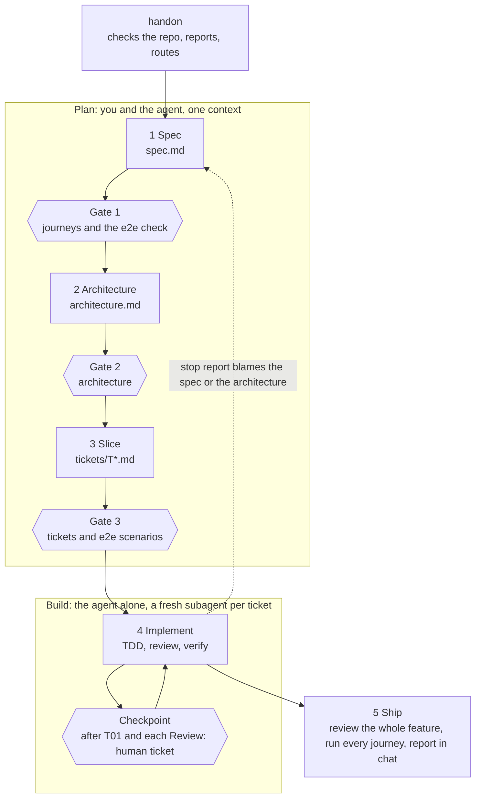
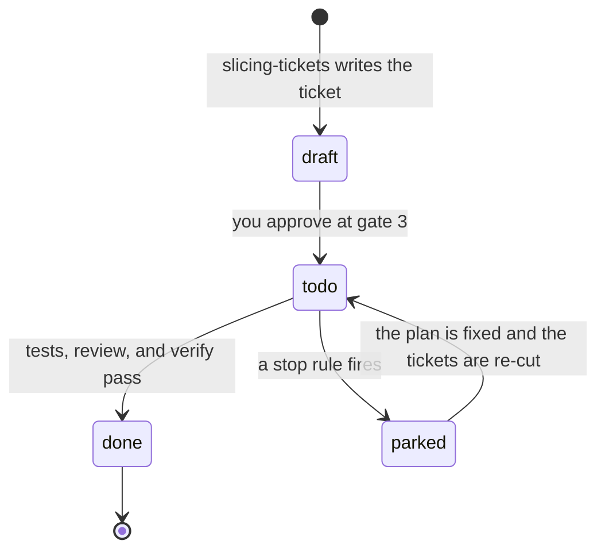

# How the workflow runs

The workflow takes a feature from an idea to a finished branch with evidence. You plan with the agent in three steps and approve each one. The agent then builds one ticket at a time, and you read the result.

This page explains how the steps connect and why they are shaped this way. Each skill's instructions live in its own `SKILL.md`, and the skill wins where this page disagrees with it.

## The flow



| Step | File | Skills | You |
|---|---|---|---|
| 1 Spec | `spec.md` | `ask-until-clear`, then `spec-it` | Approve at gate 1 |
| 2 Architecture | `architecture.md`, ADRs | `designing-architecture` | Approve at gate 2 |
| 3 Slice | `tickets/T*.md` | `slicing-tickets` | Approve at gate 3. The agent cannot change the e2e scenarios afterward. |
| 4 Implement | commits, `evidence/` | `implementing-tickets`, `reviewing-changes`, `prove-it-work` | Read the diff at each checkpoint |
| 5 Ship | `evidence/<feature>` tag | `shipping-features`, `reviewing-changes`, `prove-it-work` | Read the report and decide how to merge |

Three kinds of stop appear in the flow.

| Stop | Where | What happens |
|---|---|---|
| Gate | After steps 1 to 3 | The agent stops until you approve the file. |
| Checkpoint | Inside step 4 | The agent stops after `T01` and after every `Review: human` ticket. You read the diff and the evidence, then say "continue". |
| Stop rule | Inside step 4 | The agent parks the ticket and writes `stops/T04.md` when three attempts fail, when a decision is yours, or when the next step cannot be undone. |

A wrong idea is cheapest to fix at the start. A misunderstood journey costs one conversation in step 1. The same mistake found in step 4 costs a spec, an architecture, and code. The flow therefore puts you in steps 1 to 3 and brings you back in step 4 only at the checkpoints.

## Which skill calls which

```
handon                          entry point; the only skill that sets "Status: approved"
├─ setup                        records where the repo keeps its glossary, standard, ADRs, run instructions
└─ make-way                     writes verify-<app>; you run it when that skill is missing or out of date

1 Spec
  ask-until-clear               interview in rounds until nothing is assumed
  ├─ term-guard                 writes glossary terms and ADRs the moment they settle
  ├─ prototyping-designs        a question that talking cannot settle gets a throwaway build
  └─ research                   a technical fact from primary sources
  spec-it                       journeys, numbered criteria, non-goals; asks no questions of its own
  └─ understand-this-code       reads the code the feature touches

2 Architecture
  designing-architecture        compared designs, a code sketch, test seams, ADRs
  └─ understand-this-code

3 Slice
  slicing-tickets               vertical tickets, blocking edges, e2e scenarios; prints the ticket graph

4 Implement                     per ticket, in a fresh subagent
  implementing-tickets          TDD at the approved seams
  ├─ reviewing-changes          fresh subagent: standards, spec, tests, places to break
  └─ prove-it-work              fresh subagent: runs the real system, saves evidence

5 Ship
  shipping-features             whole-feature review, every journey, tag, report
  ├─ reviewing-changes          whole-feature mode
  ├─ prove-it-work
  ├─ quill-technical-writing    the report; applies quill-unslop
  └─ learn-from-mistakes        offered afterward

Any time
  ask-harry                     names the skill to run for the situation you describe; runs nothing
  debugging-failures            a loop that fails on demand; same stop rules as step 4
  handoff                       writes pause.md when the context fills
  evaluating-skill              evals for one skill
```

## Status and resume

`handon` keeps no state file, because it would drift from the commits. It reads git and the `Status` line of each file. The current step is the first one whose file is missing or still `draft`.

- `spec.md` and `architecture.md` carry `Status: draft` or `Status: approved`. Only `handon` sets `approved`, and only after you say so.
- Editing an approved file sets it back to `draft` and reruns its gate.
- A ticket moves through the states below. A ticket is *ready* when it is `todo` and every ticket that blocks it is `done`.



After a crash, discard the uncommitted changes and run `handon` again. The last commit is always green.

**Two sizes.** A small change is one ticket that touches no public contract, no data, and nothing unclear. `handon` proposes the size, and you confirm it in one line. A small change skips steps 1 to 3: the agent writes the ticket, shows you its e2e scenario, and goes to step 4 with no checkpoint. Every other change is full.

**A parked ticket.** The stop report names what needs fixing: `nothing`, `ticket`, `spec-it`, or `architecture`. If it blames the ticket, the agent moves on to the tickets that the parked one does not block. If it blames the spec or the architecture, the agent stops all of step 4, because the remaining tickets may rest on the same wrong assumption. You fix that file with the agent, approve its gate again, and `slicing-tickets` re-cuts the tickets.

**Why a ticket is done.** Three checks must hold: every criterion has a test that failed before it passed, `reviewing-changes` reports no serious finding, and `prove-it-work` reports `VERIFIED` with evidence in every environment the ticket lists. A verdict in one environment never offsets another.

## What ships

`shipping-features` opens no pull request. It does four things:

1. Reviews the whole diff and runs every journey on the finished branch. Each failure becomes a fix ticket that goes through step 4.
2. Tags the last commit that holds the evidence as `evidence/<feature>`. Read the evidence with `git show evidence/<feature>:<path>`, so it survives a squash merge.
3. Deletes `tickets/`, `stops/`, and `evidence/` in a new commit, and stamps `spec.md` and `architecture.md` with "as of <commit>".
4. Reports in chat, with the riskiest tickets first.

## Folder layout

The plugin:

```
skills/
├── .claude-plugin/
│   ├── plugin.json              the skill list
│   └── marketplace.json         lets /plugin marketplace add find the plugin
├── docs/                        this page and sources.md
└── skills/
    ├── start/                   handon, ask-harry, setup, make-way, handoff
    ├── plan/                    ask-until-clear, term-guard, understand-this-code, research,
    │                            prototyping-designs, spec-it, designing-architecture, slicing-tickets
    ├── build/                   implementing-tickets, debugging-failures, reviewing-changes,
    │                            prove-it-work, shipping-features
    └── craft/                   quill-technical-writing, quill-unslop, learn-from-mistakes,
                                 evaluating-skill
```

A repo that uses the workflow:

```
<repo>/
├── GLOSSARY.md                  domain terms, written by term-guard
├── CLAUDE.md or AGENTS.md       a "Workflow files" block, written by setup
├── .claude/skills/verify-<app>/ how to start and drive the real system, written by make-way
├── evals/<skill>/               cases written by evaluating-skill
└── docs/
    ├── standards.md             the coding standard that reviewing-changes reads
    ├── adr/                     ADRs
    ├── lessons.md               mistakes and the checks that block them
    └── features/<feature>/
        ├── spec.md
        ├── architecture.md
        ├── research/            notes from research
        ├── tickets/T01-*.md     deleted when the feature ships
        ├── stops/T04.md         deleted when the feature ships
        ├── evidence/T04/        deleted when the feature ships
        └── pause.md             written by handoff, deleted by handon
```
